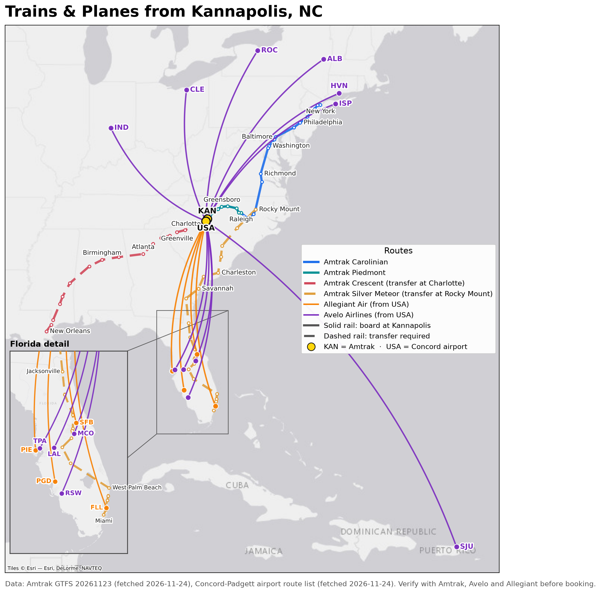

# Trains & Planes from Kannapolis, NC

Maps every train and nonstop flight you can catch from Kannapolis, North Carolina.
The route data is pulled from published sources and turned into:

- **`kannapolis_routes.html`**: an interactive [Leaflet](https://leafletjs.com/) map.
  You can switch routes on and off and click any line or stop for details.
- **`kannapolis_routes.png`**: a static, print-ready map with a zoomed Florida inset.



## What's covered

| Mode | Origin | Routes |
|------|--------|--------|
| Rail | Amtrak Kannapolis (KAN) | Every Amtrak route that stops at KAN, plus connections to the Crescent and Silver Meteor |
| Air  | Concord-Padgett Regional (USA) | Every nonstop route listed by the airport |

Rail routes and transfer stations are worked out from the schedule data, not
typed in. A direct route is any Amtrak route with a train stopping at Kannapolis.
For a connecting route, the map shows the stretch the direct trains don't cover,
starting at the station where you change trains.

## Data sources

| Data | Source | Details |
|------|--------|---------|
| Rail stops, stations, frequency | [Amtrak GTFS feed](https://content.amtrak.com/content/gtfs/GTFS.zip) | Amtrak's official schedule data. Frequency is counted over the feed's first week. |
| Nonstop flights | [Concord-Padgett Regional Airport: Airlines](https://concordairportnc.com/Airline-Information/Airlines) | The airport's official list of current and newly announced routes. |
| Airport names and coordinates | [OurAirports](https://ourairports.com/data/) | Public-domain airport database. |

Avelo and Allegiant block automated requests to their websites, so flights come
from the airport's list instead. `routes.json` records when each source was
fetched and the Amtrak feed version. Both maps print these in their footer.

> **Note:** Schedules change. Check [Amtrak](https://www.amtrak.com),
> [Avelo](https://www.aveloair.com) and [Allegiant](https://www.allegiantair.com)
> before booking.

## Usage

Requires Python 3.8+.

```sh
# 1. Refresh the route data (standard library only; downloads about 30 MB)
python3 fetch_routes.py              # writes routes.json

# 2. Build the maps
pip install -r requirements.txt      # only needed for the PNG
python3 generate_route_map.py        # writes the .html and .png
```

A copy of `routes.json` is included, so step 2 works without step 1.
To build only the HTML map, which needs no installs, run
`python3 generate_route_map.py -o kannapolis_routes.html`.

**`fetch_routes.py`**

| Option | Description |
|--------|-------------|
| `-o, --output PATH` | Where to write the data (default `routes.json`). |
| `--flights-only` | Refresh flights only and keep the rail data already in the output file. Skips the 19 MB Amtrak download. |

**`generate_route_map.py`**

| Option | Description |
|--------|-------------|
| `-d, --data PATH` | Route data to read (default `routes.json`). |
| `-o, --output PATH` | Output file, `.html` or `.png`. Can be repeated. |
| `--dpi N` | PNG resolution (default 200). |
| `--no-basemap` | Render the PNG without map tiles (works offline). |

## Customizing

- **Origin and connecting routes:** edit `ORIGIN_STATION`, `ORIGIN_AIRPORT`,
  `CONNECTING_ROUTES` and `AIRLINES` at the top of `fetch_routes.py`.
- **Colors and PNG labels:** edit `RAIL_COLORS`, `AIRLINE_COLORS` and the
  `PNG_*` label settings in `generate_route_map.py`. Routes or airlines without
  a color get one from a fallback palette.

`fetch_routes.py` stops with an error if a source changes in a way it can't parse,
so it won't quietly write incomplete data.

## Credits

Schedule data from Amtrak. Route list from Concord-Padgett Regional Airport.
Airport data from [OurAirports](https://ourairports.com/) (public domain).
Map tiles © [OpenStreetMap](https://www.openstreetmap.org/copyright) contributors
(HTML) and Esri (PNG).

## License

[GNU General Public License v3.0 or later](LICENSE).
